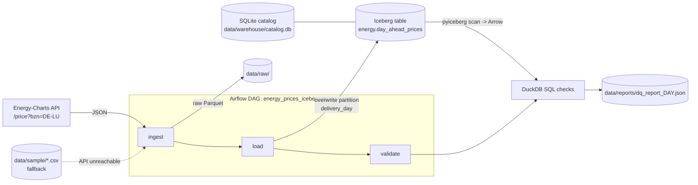

# airflow-iceberg-pipeline

[](https://github.com/hamza2829/airflow-iceberg-pipeline/actions/workflows/ci.yml)

A small daily batch pipeline. It downloads German day-ahead electricity prices
(bidding zone DE-LU) from the public [Energy-Charts API](https://api.energy-charts.info),
writes them to an **Apache Iceberg** table, checks data quality with **DuckDB**, and is
orchestrated by **Apache Airflow**. It runs locally only, with no Docker and no cloud services.

## What it does

| Step | Task | What happens |
|---|---|---|
| 1 | `ingest` | `GET /price?bzn=DE-LU&start=<day>&end=<day+1>`, raw response saved as Parquet in `data/raw/`. If the API is unreachable or returns an unexpected payload, it loads `data/sample/de_lu_day_ahead_sample.csv` instead and logs `FALLBACK USED: ...` at WARNING level. |
| 2 | `load` | Keeps only the rows of the local (Europe/Berlin) delivery day, casts them to the table schema and writes them to the Iceberg table `energy.day_ahead_prices` (pyiceberg, SQLite catalog, local warehouse folder). The write is a partition **overwrite** filtered on `delivery_day`, so re-running a day replaces it instead of duplicating it. |
| 3 | `validate` | Reads the partition from Iceberg, registers it in DuckDB and runs the SQL checks below. Writes `data/reports/dq_report_<day>.json`. If any check fails, the task raises `DataQualityError` listing each failed check. |

The DAG `energy_prices_iceberg` runs `@daily`. `ingest` and `load` retry 2 times with a
2-minute delay. `validate` has `retries=0`, because a data quality failure is
deterministic and retrying would only delay the alert.

## Architecture



Code layout:

```
pipeline/ingest.py      API call, sample fallback, raw Parquet
pipeline/transform.py   raw -> typed rows of one local day, expected rows per day (DST aware)
pipeline/load.py        Iceberg schema, partition spec, idempotent load
pipeline/quality.py     DuckDB checks, JSON report, DataQualityError
dags/energy_prices_dag.py  Airflow DAG (TaskFlow API, Airflow 3)
scripts/summarize.py    print snapshots / rows per day / price stats of the table
scripts/export_sample.py  refresh the fallback sample from a raw Parquet file
```

## Table schema

Iceberg table `energy.day_ahead_prices`, partitioned by `identity(delivery_day)`.

| id | column | type | required | notes |
|---|---|---|---|---|
| 1 | `timestamp_utc` | timestamptz | yes | start of the 15-minute delivery interval |
| 2 | `delivery_day` | date | yes | local Europe/Berlin day, **partition column** |
| 3 | `price_eur_mwh` | double | no | day-ahead price; nulls are caught by validation |
| 4 | `bidding_zone` | string | no | always `DE-LU` |
| 5 | `unit` | string | no | as returned by the API (`EUR / MWh`) |
| 6 | `source` | string | no | `api` or `sample` (fallback) |
| 7 | `ingested_at` | timestamptz | no | load time |

## Data quality checks

All checks run as SQL in DuckDB on the partition of the processed day.

| check | fails when |
|---|---|
| `not_null_key_columns` | any null in `timestamp_utc`, `delivery_day` or `price_eur_mwh` |
| `price_in_range` | any price outside [-500, 4000] EUR/MWh (based on the SDAC harmonised min/max clearing prices; set in `pipeline/config.py`) |
| `unique_timestamps` | any `timestamp_utc` occurs more than once |
| `expected_row_count` | row count is not the number of 15-minute intervals in that local day: 96 normally, 92 on the spring DST day, 100 on the autumn DST day |

Report from a real run (CI run [40093477967](https://github.com/hamza2829/airflow-iceberg-pipeline/actions/runs/40093477967), delivery day 2026-10-23):

```json
{
  "table": "energy.day_ahead_prices",
  "delivery_day": "2026-10-23",
  "checked_at": "2026-10-24T12:20:59+00:00",
  "passed": true,
  "checks": [
    {"name": "not_null_key_columns", "passed": true, "details": "no nulls in timestamp_utc, delivery_day, price_eur_mwh"},
    {"name": "price_in_range", "passed": true, "details": "all prices in [-500.0, 4000.0] EUR/MWh"},
    {"name": "unique_timestamps", "passed": true, "details": "no duplicate timestamps"},
    {"name": "expected_row_count", "passed": true, "details": "96 rows for 2026-10-23, expected 96 (15-minute intervals)"}
  ]
}
```

In that run the API returned 192 raw rows for the request `start=2026-10-23&end=2026-10-24`.
The load kept the 96 rows of 2026-10-23 (min 53.09, avg 137.59, max 226.23 EUR/MWh).
After the DAG ran twice for the same day the table still held 96 rows with 96 distinct
timestamps, in 3 Iceberg snapshots (first write; then delete + append from the overwrite).

## How to run

Requires Python 3.11.

### Tests (Windows, macOS, Linux; no Airflow needed)

```bash
python -m venv .venv
.venv\Scripts\activate          # Windows  (macOS/Linux: source .venv/bin/activate)
pip install -r requirements.txt
python -m pytest -v
```

Expected: `25 passed, 1 skipped`. The skipped test is the DAG structure test, which
needs Airflow. CI runs this exact setup on `windows-latest` and `ubuntu-latest`.

### The Airflow DAG (Linux / macOS / WSL only)

Airflow does not run natively on Windows. On Windows, use WSL2 or rely on CI, which
runs the DAG on `ubuntu-latest`.

```bash
pip install "apache-airflow==3.3.2" -r requirements.txt -e . \
  --constraint "https://raw.githubusercontent.com/apache/airflow/constraints-3.3.2/constraints-3.11.txt"
export AIRFLOW_HOME=$PWD/airflow_home AIRFLOW__CORE__DAGS_FOLDER=$PWD/dags AIRFLOW__CORE__LOAD_EXAMPLES=False
airflow db migrate
airflow dags test energy_prices_iceberg 2026-10-23
python -m pytest -v                 # now 26 passed, including the DAG test
python scripts/summarize.py         # what is in the Iceberg table
cat data/reports/dq_report_2026-10-23.json
```

All output goes to `data/` (raw Parquet, Iceberg warehouse and catalog, reports). Set
`PIPELINE_DATA_DIR` to put it elsewhere.

## CI

`.github/workflows/ci.yml` has three jobs:

* `pytest (ubuntu-latest, no Airflow)` and `pytest (windows-latest, no Airflow)`: install `requirements.txt` and run pytest.
* `pytest + airflow dags test (ubuntu)`: installs Airflow 3.3.2 with its constraints, runs
  pytest including the DAG test, then runs `airflow dags test` **twice** for yesterday (UTC).
  The second run checks idempotency: the validate task would fail on duplicates. It then
  prints the table summary and the report, and uploads `data/raw` and `data/reports` as an artifact.

## Failure drill: breaking idempotency on purpose

**The break.** Commit [`6fbbaae`](https://github.com/hamza2829/airflow-iceberg-pipeline/commit/6fbbaae)
replaced the partition overwrite in `pipeline/load.py` with a plain append, the kind of
"simplification" that looks harmless:

```diff
-    table.overwrite(rows, overwrite_filter=EqualTo("delivery_day", day.isoformat()))
+    table.append(rows)
```

**What happened.** CI run [40093799246](https://github.com/hamza2829/airflow-iceberg-pipeline/actions/runs/40093799246)
went red. The first `airflow dags test` for 2026-10-23 still passed, because the table was empty.
The second run for the same day appended the 96 rows again, and the `validate` task failed.
Real log excerpt from that run (Airflow task log, timestamps trimmed):

```
[info ] Read 192 rows for delivery_day=2026-10-23 from energy.day_ahead_prices [pipeline.quality]
[info ] [PASS] not_null_key_columns: no nulls in timestamp_utc, delivery_day, price_eur_mwh [pipeline.quality]
[info ] [PASS] price_in_range: all prices in [-500.0, 4000.0] EUR/MWh [pipeline.quality]
[error] [FAIL] unique_timestamps: 96 duplicated timestamps, first: [('2026-10-22T22:00:00Z', 2), ('2026-10-22T22:15:00Z', 2), ('2026-10-22T22:30:00Z', 2)] [pipeline.quality]
[error] [FAIL] expected_row_count: 192 rows for 2026-10-23, expected 96 (15-minute intervals) [pipeline.quality]
[info ] Wrote data quality report to .../data/reports/dq_report_2026-10-23.json [pipeline.quality]
[error] Task failed with exception [task]
  File ".../dags/energy_prices_dag.py", line 55, in validate
    report = validate_day(date.fromisoformat(day))
  File ".../pipeline/quality.py", line 134, in validate_day
    raise DataQualityError(f"{len(failed)} of {len(results)} checks failed for {day}: {summary}")
pipeline.quality.DataQualityError: 2 of 4 checks failed for 2026-10-23: unique_timestamps: 96 duplicated timestamps, first: [('2026-10-22T22:00:00Z', 2), ('2026-10-22T22:15:00Z', 2), ('2026-10-22T22:30:00Z', 2)]; expected_row_count: 192 rows for 2026-10-23, expected 96 (15-minute intervals)
[info ] Task instance state updated ... new_state=failed
[info ] DagRun Finished: dag_id=energy_prices_iceberg, logical_date=2026-10-23 00:00:00+00:00, ... state=failed
DagRun failed
```

The same run's `scripts/summarize.py` output showed the cause in the table itself:
**192 rows, 96 distinct timestamps** for 2026-10-23, so every interval was stored exactly twice.
The unit tests caught it as well: `3 failed, 22 passed, 1 skipped`. The 3 failures were
`test_loading_the_same_day_twice_does_not_duplicate_rows`,
`test_reload_replaces_the_rows_of_that_day` and `test_reload_of_one_day_keeps_other_days`.

**How the logs pointed to the cause.** Exactly every timestamp was duplicated, with a count of 2
and 192 = 2 × 96. That rules out bad source data, where you would expect a few duplicates or
odd counts, and points to the same day being written twice. The failing unit tests are all about
re-loading a day, which narrows it to `load_day`.

**What was misleading.** The `load` task logged
`Overwrote partition delivery_day=2026-10-23 with 96 rows` while it was appending.
The message described what the code was meant to do, not what happened.

**The fix.** Commit [`6673019`](https://github.com/hamza2829/airflow-iceberg-pipeline/commit/6673019)
restored the partition overwrite. It also changed the load log to report what the partition
really holds after the write, so a future duplicate shows up in the `load` log already, not
only in `validate`. CI run [40093947596](https://github.com/hamza2829/airflow-iceberg-pipeline/actions/runs/40093947596)
on the fix was green: `26 passed`, and both DAG runs for 2026-10-23 ended with `state=success`.
The second run logged:

```
[info ] Wrote 96 rows for delivery_day=2026-10-23; partition now holds 96 rows (snapshot 5744749175987265260) [pipeline.load]
```

## Limitations

* **Local only.** The warehouse is a local folder and the catalog is a SQLite file. A
  SQLite catalog is fine for development but not for production: there is a single writer,
  there is no access control, and other engines and machines cannot share it. In production
  this would be a REST, Glue, Hive or Nessie catalog on object storage.
* **Small data.** One bidding zone, 96 rows per day. pyiceberg + DuckDB in one process
  is the right tool at this size, and none of this is a performance claim.
* **DuckDB reads via pyiceberg.** pyiceberg scans the Iceberg partition into Arrow, and DuckDB
  runs the checks on that Arrow table. The DuckDB `iceberg` extension is not used.
* **The fallback sample is one fixed day** (2026-10-23, captured from the API in CI). On fallback
  the pipeline loads that day, not the requested one, and logs both dates.
* **Fixed 15-minute resolution.** The row-count check assumes the 15-minute day-ahead market
  time unit (SDAC switched to it on 2025-10-01). Only days after that were run; older days
  with hourly prices would not match the expected count.
* **Airflow is only exercised with `airflow dags test`.** That runs the tasks in a single
  process, so no scheduler, webserver or real deployment was run. On Windows, Airflow can
  only run via WSL2 or CI.
* **No backfill logic or alerting** beyond the failed task. With `catchup=False`, missed days are not loaded automatically.
